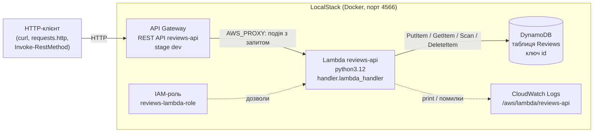
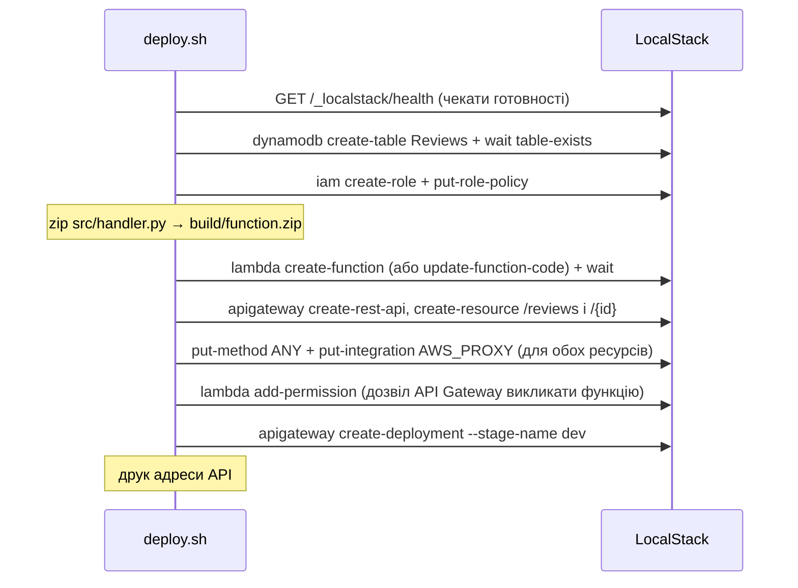

# Serverless-відгуки в LocalStack

Невеликий HTTP API відгуків на товари, адаптований з `Reviews.Api` для AWS Lambda. Застосунок розгортається в [LocalStack](https://www.localstack.cloud/) (локальний емулятор AWS у Docker), доступний через Amazon API Gateway і зберігає дані в Amazon DynamoDB. Справжній обліковий запис AWS не потрібен.

## Архітектура



- **API Gateway** приймає HTTP-запит і за маршрутом (`/reviews` або `/reviews/{id}`, метод `ANY`) передає його в Lambda як JSON-подію. Інтеграція `AWS_PROXY` передає запит повністю, без перетворень: метод, шлях, заголовки, тіло й параметри.
- **Lambda** (`src/handler.py`) сама розбирає подію, перевіряє дані, звертається до DynamoDB через `boto3` (є в рантаймі Lambda) і повертає `statusCode`, `headers` і `body`.
- **DynamoDB**: таблиця `Reviews`, ключ розділу `id` (рядок), режим `PAY_PER_REQUEST`. Схему задає лише ключ, решту полів кожен запис має свої.
- **IAM-роль** дозволяє функції чотири дії над таблицею й запис логів. LocalStack Community ці політики не перевіряє, але скрипт створює їх так, як на справжньому AWS.
- Ресурс `/reviews/{id}` дає функції параметр `pathParameters.id`.

## API

| Метод і шлях | Що робить | Відповідь |
|---|---|---|
| `POST /reviews` | створити відгук | `201` + запис |
| `GET /reviews` | усі відгуки, нові першими | `200` + масив |
| `GET /reviews?productId=<guid>` | відгуки одного товару | `200` + масив |
| `GET /reviews/{id}` | один відгук | `200` або `404` |
| `DELETE /reviews/{id}` | видалити відгук | `204` або `404` |

Тіло `POST` (`Content-Type: application/json`) має ті самі поля, що й `Reviews.Api`:

```json
{ "productId": "11111111-1111-1111-1111-111111111111", "rating": 5, "comment": "Great keyboard" }
```

Сервер сам додає `id` (GUID) і `createdAtUtc`. Правила перевірки:
- `productId` має бути непорожнім GUID;
- `rating` — ціле число від 1 до 5;
- `comment` — рядок до 1000 символів.

Порушення дають `400` з `{"error": "..."}`. Тіло не JSON-типу дає `415`, метод поза таблицею — `405`. Неіснуючий шлях (наприклад `/other`) відхиляє сам API Gateway ще до Lambda: `403 Missing Authentication Token`, як і в справжньому AWS.

## Що потрібно

- Docker Desktop.
- AWS CLI v2: `winget install Amazon.AWSCLI`.
- Git Bash (або Linux/macOS) для скриптів, Python 3 для пакування zip і юніт-тестів.

Облікові дані для LocalStack фіктивні (`test` / `test`, регіон `us-east-1`). Скрипти виставляють їх самі, тому `aws configure` не потрібен.

## Розгортання

```bash
cd serverless
docker compose up -d     # LocalStack 4.14.0 на http://localhost:4566
bash deploy.sh           # таблиця, роль, Lambda, API Gateway, stage dev
bash test-api.sh         # 13 перевірок HTTP API через curl
```

`deploy.sh` наприкінці друкує адресу API і зберігає її в `build/api-url.txt`:

```
http://localhost:4566/restapis/<api-id>/dev/_user_request_/reviews
```

Те саме API доступне й за адресою `http://<api-id>.execute-api.localhost.localstack.cloud:4566/dev/reviews` (домен `localhost.localstack.cloud` вказує на `127.0.0.1`).

### Послідовність `deploy.sh`



Скрипт **ідемпотентний**, тобто його можна запускати повторно:
- таблиця, роль і API створюються, лише якщо їх ще немає;
- код функції щоразу оновлюється (`update-function-code`);
- API щоразу перерозгортається.

Тому після зміни `src/handler.py` достатньо знову запустити `bash deploy.sh`.

### Прибирання

```bash
bash destroy.sh          # видалити API, функцію, роль і таблицю
docker compose down      # зупинити LocalStack
```

LocalStack Community нічого не зберігає між перезапусками: після `docker compose down` / `up` усі ресурси й дані зникають, і `deploy.sh` треба виконати знову.

## Перевірка HTTP-клієнтом

- `bash test-api.sh` проганяє 13 запитів (створення, список, фільтр, читання, помилки 400/405/415, видалення, 404 після видалення) і звіряє коди відповідей.
- `requests.http` містить ті самі запити для REST Client у VS Code або HTTP Client у JetBrains. Підстав `api-id` з `build/api-url.txt`.
- PowerShell:

```powershell
$base = "$(Get-Content serverless\build\api-url.txt)/reviews"
$r = Invoke-RestMethod -Method Post -Uri $base -ContentType 'application/json' -Body '{"productId":"11111111-1111-1111-1111-111111111111","rating":5,"comment":"Great"}'
Invoke-RestMethod $base
Invoke-RestMethod "$base/$($r.id)"
Invoke-RestMethod -Method Delete "$base/$($r.id)"
```

- Дані напряму в DynamoDB і логи функції:

```bash
aws --endpoint-url http://localhost:4566 dynamodb scan --table-name Reviews
aws --endpoint-url http://localhost:4566 logs tail /aws/lambda/reviews-api
```

## Юніт-тести

```bash
cd serverless
python -m unittest discover -s tests -v
```

8 тестів викликають `lambda_handler` з подіями у форматі API Gateway і фейковою таблицею замість DynamoDB, тому не потребують ні LocalStack, ні `boto3`.

## Особливості та обмеження

- **Версія LocalStack закріплена на 4.14.0.** Новіші образи `localstack/localstack` (2026.x) без `LOCALSTACK_AUTH_TOKEN` не запускаються (`License activation failed`). 4.14.0 — остання версія Community, якій токен не потрібен. Щоб перейти на новішу, треба зареєструватись у LocalStack, виставити `LOCALSTACK_AUTH_TOKEN` у середовищі і змінити тег у `docker-compose.yml`.
- **API Gateway v1 (REST API), а не v2 (HTTP API)**, бо HTTP API у LocalStack доступний лише в платній версії.
- **Тіло запиту без `Content-Type: application/json`.** Curl тоді шле `application/x-www-form-urlencoded`, і LocalStack перекодовує таке тіло як форму (`%7B%22productId...=`). Справжній AWS передав би тіло як є. Тому функція приймає лише JSON і на інші типи відповідає `415`.
- **`GET /reviews` читає всю таблицю (`Scan`)** і фільтрує за `productId` у коді. Для навчальної таблиці цього досить. Для великої таблиці потрібен глобальний вторинний індекс за `productId` і `Query`.
- **Перший виклик після розгортання повільніший (~1–2 с):** LocalStack запускає контейнер Lambda (cold start). Наступні виклики тривають мілісекунди.
- **Lambda працює в окремих Docker-контейнерах**, які LocalStack створює через `/var/run/docker.sock`. Тому сокет Docker примонтовано в `docker-compose.yml`.
